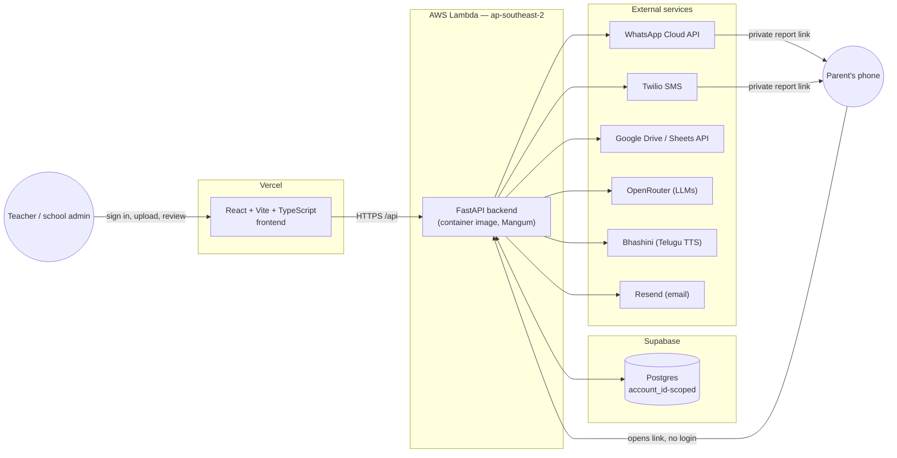
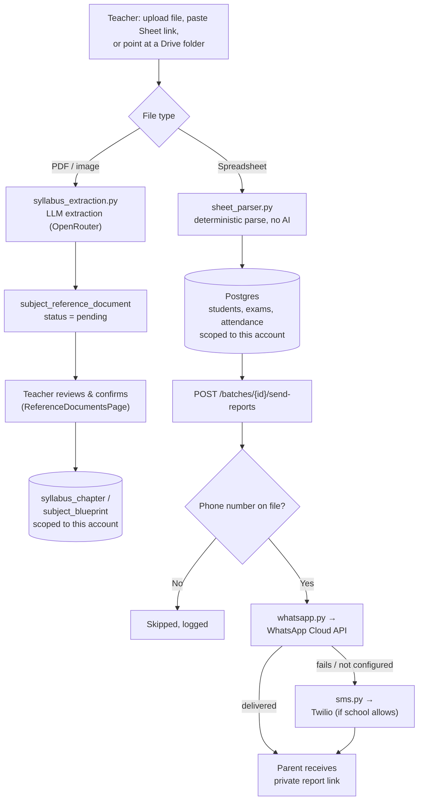
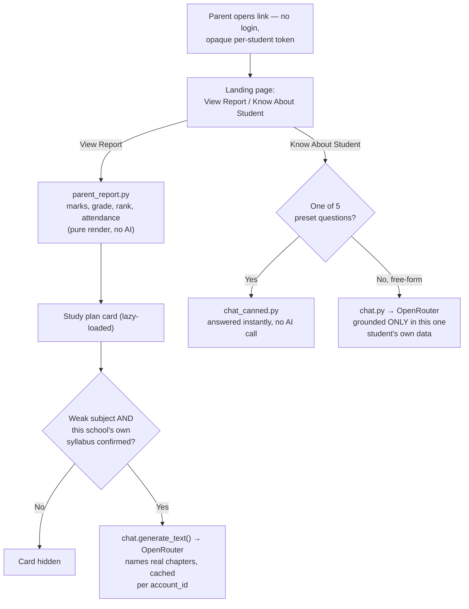

# Interactive Progress Report

A multi-tenant SaaS app for Indian government school teachers: upload a
class's marks spreadsheet — or just point it at a Google Drive folder — and
it generates a digital progress card per student, delivered straight to a
parent's WhatsApp or SMS as a private link. No app install, no login for
parents, built for low digital literacy and patchy connectivity.

**The active application lives in [`report-card-app/`](report-card-app/)** —
see [`report-card-app/README.md`](report-card-app/README.md) for the
full stack/feature breakdown and [`report-card-app/docs/`](report-card-app/docs/)
for the deployment runbook and engineering-level data-flow doc. This
top-level README covers the overall architecture and hosting picture, with
diagrams.

> The root-level `backend/` and `frontend/` folders in this repo are an
> earlier SQLite-based prototype, superseded by `report-card-app/` (Postgres,
> multi-tenant, WhatsApp/SMS delivery, AWS Lambda hosting). They're kept
> around for reference only and aren't deployed anywhere.

## System architecture



- **Frontend** — Vercel, static Vite build. Does not auto-deploy from GitHub
  pushes on this project; redeploy manually from the Vercel dashboard.
- **Backend** — AWS Lambda, container image (`report-card-backend` function,
  `reprot-card-backend` ECR repo), invoked via a public Function URL. No
  "sleeping" like a free-tier PaaS would — worst case is a short cold start.
- **Database** — Supabase Postgres, same region as Lambda (`ap-southeast-2`)
  to keep DB round-trips fast.
- **Rollback path** — the previous Render deployment of the backend is left
  running, unused, as an instant fallback.

Full details — env vars, the Mangum Lambda entry point, Docker build flags,
measured cold-start numbers — are in
[`report-card-app/docs/AWS_LAMBDA_DEPLOYMENT.md`](report-card-app/docs/AWS_LAMBDA_DEPLOYMENT.md).

## Data flow: upload → delivery



A school that hasn't uploaded and confirmed its own syllabus/blueprint data
never falls back to showing another school's — see "Multi-tenancy" below.

## Data flow: a parent opens the link



Every report page and every chat answer is scoped to exactly one student via
an unguessable share token — a parent link can never see another student's
or another school's data.

## Multi-tenancy & data isolation

Every table that holds school-specific data carries an `account_id` /
`user_id`, and every repository function and API route is scoped to the
authenticated caller. Syllabus/exam-blueprint data additionally supports a
nullable `account_id` for template/global rows — but the lookup functions
only ever return an account's **own** confirmed data; a school that hasn't
uploaded its own syllabus simply sees nothing there, never another school's
real curriculum presented as if it were theirs. The same rule applies to the
parent-facing report's hero photo: a school's own uploaded photo, or a
plain blank banner — never another real school's photo as a stand-in.

## Stack at a glance

| Layer | Technology |
|---|---|
| Backend | Python 3.13, FastAPI, psycopg 3 (connection-pooled), JWT auth (`PyJWT` + `bcrypt`) |
| Frontend | React 19, TypeScript, Vite, Tailwind CSS v4 |
| Database | Postgres (Supabase) |
| AI | OpenRouter (chat, study plan, document extraction) — all traced via LangSmith, tagged per `account_id` |
| Messaging | WhatsApp Cloud API (primary), Twilio SMS (fallback) |
| Other integrations | Google Drive/Sheets API (reading shared folders, no OAuth), Bhashini (Telugu TTS), Resend (password-reset email) |

See [`report-card-app/README.md`](report-card-app/README.md) for the full
feature list, local dev setup, and project layout.

## Running it locally

```bash
cd report-card-app/backend
python -m venv venv
venv\Scripts\pip install -r requirements.txt
venv\Scripts\python -m uvicorn app.main:app --port 8010
```
```bash
cd report-card-app/frontend
npm install
npm run dev
```
The frontend's Vite dev server proxies `/api/*` to `http://127.0.0.1:8010`
(see `report-card-app/frontend/vite.config.ts`) — the backend must be
started on that exact port locally, or the frontend gets a Bad Gateway on
every API call.
